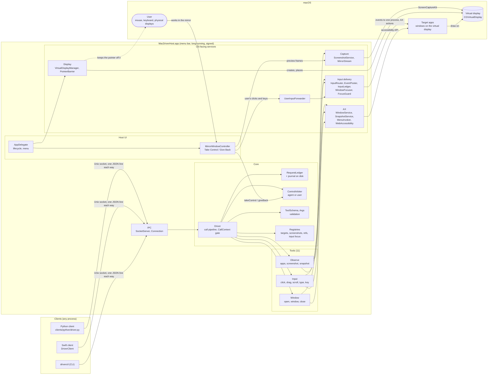
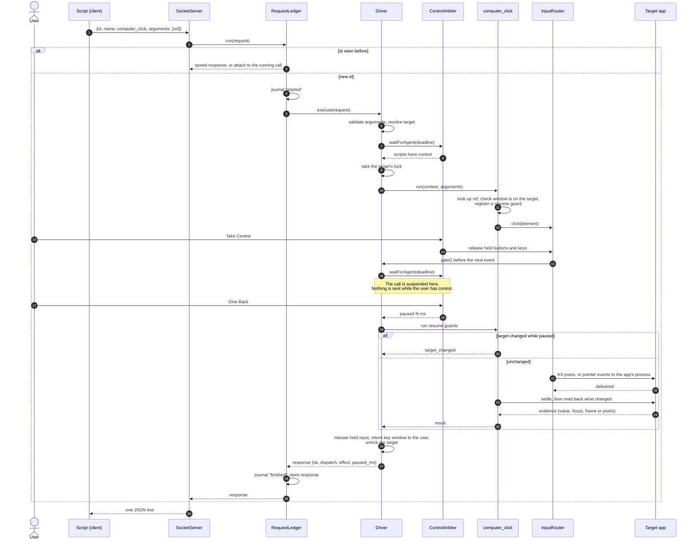

# MacDriver design

## Components

The same structure as text:

- **Clients** send one request per connection: `driver.call` in Python or Swift, or `driverctl`.
- **IPC** parses each line and hands tool calls to `Driver`.
- **Core** decides whether and when a call runs: the ledger (once per id), validation, the target, the arbiter (who has control) and the per-target lock.
- **Tools** are the 11 `computer_*` implementations. They never talk to macOS directly; they use the services.
- **Services** are the only code that touches macOS: accessibility, input delivery, capture and the display.
- **Host UI** owns the lifecycle and the mirror. The user's input in the mirror goes through the same `InputRouter` as script input.

Swift targets:

| Target | Contents |
|---|---|
| `DriverProtocol` | Wire types shared with clients. |
| `CPrivate` | Private API declarations. |
| `DriverCore` | All OS-facing logic, unit-testable apart from the UI. |
| `MacDriverHost` | AppKit shell: menu bar, mirror window and lifecycle. |
| `driverctl` | CLI client. |
| `DriverFixture` | Test app with known controls, including custom views with no accessibility actions. |

**Why a long-running host app.** Three things only work in one long-lived, signed process:
- The virtual display exists only while the process that created it is alive.
- macOS grants Accessibility and Screen Recording to a specific signed app.
- Screenshot ids, element refs and the idempotency ledger must persist between calls.

So `driver.call` is a thin client that talks to the host over a socket.

## Virtual monitor

**Creation.** `CGVirtualDisplay` (private CoreGraphics API, also used by DeskPad and BetterDisplay) creates a 1920×1080 HiDPI display. It is created once at startup and released only at shutdown. Mirror, pause and control changes never touch it.

**Arrangement guard.** Spike on macOS 26.2: creating the display made macOS insert it between the built-in and external monitors, and shift the external monitor from x=1512 to x=3432. To undo that, the guard:

1. records the physical origins and the main display before creation;
2. restores them afterwards;
3. parks the virtual display diagonally off the bottom-right corner of the physical layout, so the two touch at a single point and share no edge;
4. re-runs (debounced and idempotent) on every display reconfiguration, and adopts a new physical layout when monitors are plugged in or out.

All changes use `kCGConfigureForAppOnly`, so if the host crashes, macOS reverts them. `status.arrangement_deviations` reports any drift.

**Pointer barrier.** A session event tap warps the hardware cursor back if it would enter the virtual display's bounds, which covers the corner point. The driver's own input never moves the cursor: it is posted per-process. The user's input during takeover is forwarded the same way. The cursor is returned to the nearest point on a real display, 16 points in from its edges so it stays visible. That point is computed from the current layout each time, not remembered: when a monitor is unplugged the displays move, and a remembered position can end up inside the virtual display, which would hold the cursor on a screen the user cannot see. After every layout change the barrier also checks whether the cursor was left on the virtual display and moves it back. `status.pointer` reports the cursor's position, whether it is on the virtual monitor, and the barrier's recent stops.

**User windows.** Only windows created by `computer_open` (found by diffing the window list before and after) are moved onto the target. Existing windows on other displays are reported as `on_other_display_not_moved`. At shutdown, driver-placed windows still on the virtual display are moved back to their original display before it is released, so no content is stranded.

**Lifecycle.** `starting → ready ⇄ user_control → stopping → stopped`, or `failed(reason)`. These states are shown in the menu-bar item and the mirror window. SIGTERM, SIGINT and SIGHUP run the same graceful shutdown:

1. Cancel calls.
2. Release held input.
3. Stop the stream.
4. Return windows.
5. Release the display.
6. Remove the socket.

A stale socket left by a crash is detected (connect fails) and replaced at the next start. A live socket means another host is running, and startup refuses.

## Driver

**Request pipeline** (`Driver.call` → `Driver.execute`):

1. **Idempotency ledger.** The same id with the same request attaches to the running call or replays its stored result. A different request under the same id fails with `id_conflict`. Results with no side effects are not stored, so they can be retried.
2. **Journal.** Calls that can have side effects are written to `requests.journal` when they start and when they finish. After a host restart, a finished id is replayed, and an id that started but never finished is answered with `unknown_outcome` instead of being run again. The journal is compacted at startup and after every few thousand records, and records older than a day are dropped.
3. **Argument validation.** Each tool declares its parameters once (`ToolSchema.swift`). That declaration rejects unknown keys, wrong types, out-of-range values and missing required parameters before the tool body runs, and it is also what the `tools` listing publishes as JSON Schema. Rules that span parameters ("`ref` or `in`+`x`+`y`, never both") stay in the tool.
4. **Target resolution.** The default is the virtual monitor. Physical displays must be named. There is never a fallback.
5. **Mutating tools only.**
   1. Wait while the user has control (paused, up to the deadline).
   2. Take the per-target lock, so actions never interleave. A call that pauses later keeps the lock, so queued calls stay in order.
6. **Gate before every event.** `CallContext.gate()` runs before each individual input event. It throws on cancellation or deadline. If the user has control it *suspends* the call there, and after Give Back runs the call's resume guards before letting it continue.
7. **Always release.** `InputLedger` records who holds each button and key: one call, or the user in the mirror. When a call ends on any path (success, error, cancel), only its own held input is released, with key-up and button-up events. A takeover releases what scripts hold and marks those calls as interrupted, but leaves the user's input alone. Shutdown releases everything.
8. **Response.** `dispatch` comes from the number of events delivered. `effect` comes from what was observed (below).

**One call, start to finish.** A `computer_click` on a ref, with the user taking control partway through:

Without a takeover, steps 13 to 20 do not happen and the click goes straight from the router to the app.

**Pause and resume.** A takeover cancels nothing. The call that is running stops at its next gate, and three rules decide what happens on Give Back:

- **Resume guards.** When a tool resolves its target it registers a guard. The guard records the state it depends on when the pause begins, and checks it when the pause ends. Pointer tools check that the same window is still what a click at that point would hit. `type` and `key` check that the same element still has keyboard focus and the caret has not moved. Window tools check that the window still exists on the target. A failed guard ends the call with `target_changed`.
- **Held gestures are not resumed.** If the takeover found a button or key held (a drag in progress), it was released, and the gesture cannot be continued from the middle. The call ends with `user_has_control` and `resumable: false`.
- **The deadline still applies.** Paused time counts toward `timeout_ms`.

**Input without taking over the user.** `InputRouter` is the one place that decides how pointer input is delivered. The driver's tools and the mirror's `UserInputForwarder` both call it, so a click behaves the same whether a script or a person made it. It picks one rung per gesture, gentlest first, and never combines them:

| Rung | Used for | How |
|---|---|---|
| Element | A click on a snapshot `ref` that can be pressed | `AXPress` on that element. |
| Text, control | Left clicks on editable text and on standard controls | `SemanticPointer`: the caret, word, line or range is set through AX selected-range and point-to-character mapping, and a control under the point is pressed through AX. |
| Events | Everything else: custom views, right and middle clicks, modified clicks, drags, wheel scrolling | `CGEvent.postToPid`. The events bypass HID, so the user's cursor and keyboard state are untouched. |

Three things make the events rung work in a background app. Each was found by experiment against the fixture app, whose event log shows what an app actually receives:

| Step | Why |
|---|---|
| Stamp each event with its window (event field 51) and its position inside that window (`CGEventSetWindowLocation`) | Events that go through the window server get these there. Events posted straight to a process do not, and AppKit then finds no view for them: they arrive and are dropped. |
| Make the window key inside its app (`WindowFocuser`, SkyLight's `SLPSPostEventRecordTo`) | Keyboard input goes to the app's key window. |
| Tell the app it is active (`WindowFocuser.ensureBelievesActive`, the AppKit-defined "application activated" event, posted to that process only) | AppKit discards a first click on any view that does not accept first clicks (the default) while the app knows it is inactive. |

None of the three changes anything outside the target process. The system's frontmost app, the menu bar and the destination of the user's real keystrokes stay as they were; `Tests/E2E/fixture.py` checks the frontmost app before and after. The "active" belief is left in place between actions, because withdrawing it would close menus and popovers an action has just opened. It is withdrawn at shutdown and when the user sends a window back to a physical display. `FocusGuard` remains as a safety net: if a target app activates itself for real, the previously frontmost app is re-activated and the response carries a warning.

**Apps that activate themselves.** The above covers what the driver sends. An app can still ask the system for activation on its own: Chrome does every time it shows a new window, whether that comes from its menu, its command line or a reopen request, and telling it beforehand that it is already active does not stop it. Nothing outside the app can refuse that request. `FocusGuard` therefore listens for the activation during each action and re-activates the previously frontmost app as soon as it is announced (measured at about 8 ms with Chrome), and the response carries a warning. The guard only reacts to the app the action targets, so a user who switches apps during an action is left alone.

Other AX actions (`kAXPosition`/`kAXSize`, `kAXMinimized`, the close button, menu items) serve the window and open tools.

**Confirming effects.** `EffectProbe` wraps each action:

- An `AXNotificationWatch` subscribes to the target app's accessibility notifications for the duration of the action. The app announcing "value changed" or "sheet created" is the signal that it reacted, and it arrives when the reaction happens. This is reported as `ax_notification` plus the specific names.
- A before/after comparison of the screen fingerprint (a 64×36 grayscale hash through SCK), the AX focused element, the AX value and the window frame covers apps that announce nothing.
- The wait ends when the app has gone quiet after announcing something, or else when the screen stops changing. `computer_window` and `computer_close` wait on the same notifications instead of sleeping a fixed interval.

Focus notifications are recorded but do not count as confirmation, because the driver's own preparation (making the window key) produces them.

**Input location.** Typing and keys go only to the window and element recorded by the last valid click on that target. The input is rejected if any of these hold:
- that window is gone, hidden or off target;
- the app's focused window changed to a different document window (sheets and dialogs are allowed);
- the element died;
- the user took control since the click.

**Exactly once.** The ledger and journal prevent duplicate calls. `computer_type` never retries chunks internally. If it stops early, it reports `partial` and how many characters were sent.

**Private APIs are optional at runtime.** `CGVirtualDisplay` and `_AXUIElementGetWindow` are weakly linked, and the SkyLight and event-stamping calls are resolved with `dlsym`. `Capabilities` probes each one. A missing one is logged at startup and listed in `status.capabilities` with what is lost without it, and the code path degrades (for example, windows are matched by owner and frame when the window-id lookup is missing) instead of crashing at launch.

**Concurrency.** The package builds in Swift 6 language mode. Shared mutable state lives behind one audited primitive (`Locked`) or in actors, and the host UI is `@MainActor`, so the compiler rejects unsynchronized access. The remaining `@unchecked Sendable` types wrap system objects (capture stream, event tap, display, socket). Mutating calls are serialized per target. Observation calls run concurrently, and also while the user has control. The socket server handles connections concurrently and pipelines requests by id.

**Socket access.** The socket and its directory are private to the user (`0600` / `0700`), and each connection's peer user id is verified with `getpeereid`, so access does not depend on the file modes staying intact.

## Resource use

Measured on an Apple-silicon Mac running macOS 26.2, debug build, with `top` and `ps`.

| State | Host CPU | Host memory |
|---|---|---|
| Idle, mirror window open, nothing changing on the virtual monitor | about 0.3% of one core (was about 4%) | 27 MB |
| Working: 25 calls in 12 s (screenshots, snapshots and scrolls on a web page) | about 12% of one core, 60 ms of CPU per call | 77 MB |

The idle figure was taken without checking whether the mirror window was covered by other windows at the time; if it was, the stream was stopped and the figure with a visible mirror is higher.

What keeps it low:

- **The mirror is captured only while it can be seen.** The stream stops when the mirror window is closed, minimized or fully covered, and starts again when it shows. It runs at 12 frames a second while scripts work and at 30 only while the user has control and is working in it. The picture is captured at the size it is shown at.
- **Nothing polls.** The host waits on the socket, on accessibility notifications and on display-change callbacks. There are no timers while idle.
- **The pointer barrier has its own thread.** It answers each pointer movement with two comparisons and never waits for the host's main thread, so host work cannot be felt as pointer lag.
- **Web page accessibility is requested only when needed.** Chromium-based apps spend CPU keeping their page tree current once a client asks for it. The driver asks on the first `computer_snapshot` of such an app, never for screenshots, and withdraws the request at shutdown.
- **Screenshot files are capped** at the 40 most recent (they are about 1 MB each).

## Disruption to the user's desktop

What the user can notice, and how much:

| Event | Effect on the user | Size |
|---|---|---|
| Input to an app in the background | None. Events go to the app's process; the pointer, the frontmost app and the menu bar do not change. | — |
| An app activates itself (Chrome on "New Window") | The frontmost app changes and is changed back. A key typed in that moment could go to the other app. | About 8 ms, measured |
| A new window opens on a real display before it is moved to the virtual monitor | The window is visible on the user's screen for a moment. | Under a second |
| The driver types into a window of an app the user is also using (a second browser window) | That app has one key window, so the user's typing in it is misdirected while the action runs. | The length of one action |
| The pointer is pushed into the corner where the virtual monitor touches the real ones | It is put back 16 points inside the real display, so it stays visible. | — |
| The host starts | Its mirror window appears without taking focus. | — |

**Sharing an app with the user.** The five everyday tasks all run in the user's own browser, because that is where their sign-ins are. An app has a single key window, and keys posted to an app go to that window, so three rules apply:

1. Before any key is sent, the driver makes its window key and asks the app whether it is. If it is not, nothing is sent and the call fails with `no_input_target`: keys never go to "whichever window is key".
2. The window that was key before (the user's) is remembered. If the user is in that app, it is made key again when the action ends, and the response carries a warning. If the user is elsewhere, it is made key again the moment they switch to the app.
3. Key status is not handed back after every action regardless, because a page that loses it closes the menus and suggestion lists a click has just opened.

## Web pages

Three things were needed before a browser could be driven, each found by running the tasks below:

- **Page content has to be asked for** (see Resource use). Chrome accepts only the attribute VoiceOver uses; Electron apps accept a side-effect-free one, which is tried first.
- **Clicks are real pointer events.** Pressing a link through accessibility navigates, but the page sees no pointer. A shop answered such a press with an "are you human" check; with a pointer move, press and release at the element's position, the same link opened normally.
- **Snapshots have to be narrowed** (`scope`, `detail`, `query`, described in PROTOCOL.md), or they are cut off before they reach what the script is looking for.

**The five example tasks**, run through `driver.call` against the user's Chrome on the virtual monitor:

| Task | Result |
|---|---|
| X: like the first post in the feed | Done once the user had signed in: the feed loaded, the first post's Like button was found with `query`, and after the click it read "48 Likes. Liked" (47 before). |
| Amazon: find smart glasses, add to cart | Done: searched, opened the first result, pressed "Add to cart"; the cart shows 1 item. Nothing was bought. |
| Email: summarize the three latest unread, draft a reply | Done in Gmail: the three rows were read from a snapshot, the latest was opened, and a reply was typed and left unsent. |
| Uber Eats: three dinner options under 30 minutes | Not possible from this location: the site shows that the service has shut down in Brazil. Run on iFood instead: the address was set from the browser's location (the user approved the permission prompt), the list was scrolled through with wheel events, and the 89 restaurant cards were read with `query`. Three had an upper delivery estimate under 30 minutes. |
| Calendar: 30-minute "Focus time" tomorrow at 3 PM | Done in Google Calendar and verified in the day view: 3:00–3:30 PM. |

## Known limitations

- Several private or undocumented pieces are involved: `CGVirtualDisplay`, `SLPSPostEventRecordTo`, `CGEventSetWindowLocation`, `_AXUIElementGetWindow`, event field 51 and the AppKit-defined activation event. They are verified on macOS 26.2 and probed at runtime where possible, but any of them could change. Field 51 and the activation event cannot be probed; if they stopped working, clicks on custom views would report `effect.confirmed: false`.
- Verified against two apps: TextEdit and the fixture app. Other toolkits (Electron, Catalyst, games that read HID state directly) have not been tested and may ignore per-process events. The driver then reports `effect.confirmed: false` instead of activating the app.
- An app the driver works with considers itself active until the host shuts down. It may draw its windows in the active style, and anything it does only while active (for example, a timer that pauses in the background) keeps running.
- Text clicks still go through `SemanticPointer` rather than real events, so word selection follows a simple rule (letters, digits, underscore) instead of the app's own. Now that real events reach background apps, this rung could be retired after testing on more apps.
- Title-bar drags are handled by the window server, which per-process events never reach. `computer_drag` detects that the window did not move and applies the same offset through `kAXPosition` (`method: events+ax_window_move`). `computer_scroll` has the same kind of verified fallback through the scroll bar for apps that ignore wheel events.
- A paused call that held a button when the user took control is ended, not resumed.
- The journal protects against the host process dying, not against power loss: records are written but not synced to disk.
- TextEdit and other document apps autosave: closing an edited, file-backed document saves it without a prompt (`status: closed`, content preserved). Untitled documents with content raise a prompt (`status: prompt_pending`), and the driver never answers it on the caller's behalf.
- With Stage Manager on, windows do not minimize: the app accepts the request and the window stays where it is, on every display. In the end-to-end run TextEdit also came to the front at that step, which the driver must never cause. `computer_window` then returns `state: normal` with a warning, and `status.capabilities.stage_manager_off` reports `available: false`. The driver does not change the setting; all four end-to-end suites pass with Stage Manager off.
- Points over system chrome (menu bar, Dock, Control Center) are rejected as `unsupported`, because system UI can't take per-process input.
- Key codes assume a US/ANSI layout. `computer_type` sends literal Unicode, so typing is layout independent.
- Newly opened windows appear briefly where the app puts them (usually the main display) before they are moved to the target.
- The pointer barrier cannot be exercised by the automated tests, because simulated mouse movement from a test process does not reach it. Its choice of return point is unit-tested, and returning a cursor placed on the virtual display was checked by hand with a real mouse. The rescue after a monitor is unplugged has not been triggered for real.
- Test-only IPC ops exist for the end-to-end suites. They are rejected unless the host was launched with `--test-ops`.
- Without a stable signing certificate the build is ad-hoc signed, and macOS permission grants reset on every rebuild. Create a "MacDriver Dev" certificate or set `MACDRIVER_SIGN_IDENTITY`.
